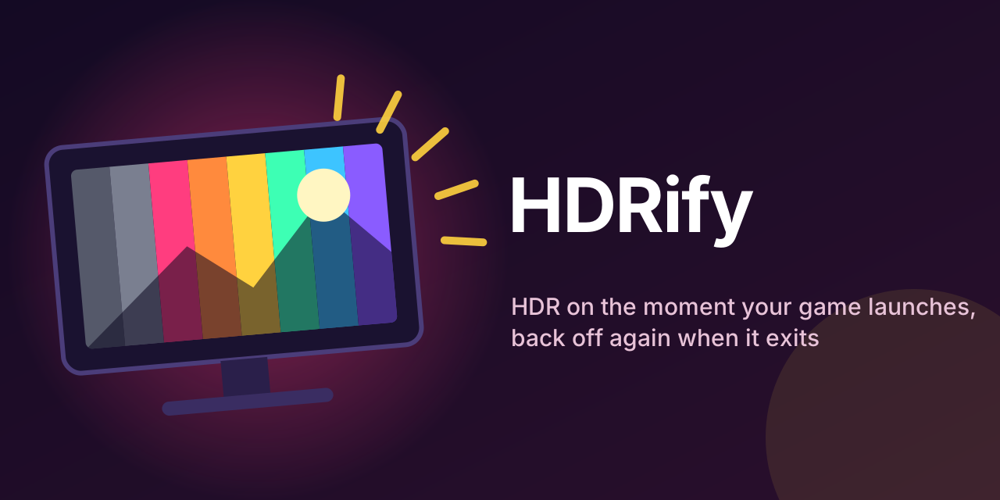

# HDRify

Turns HDR on for every HDR-capable display when a watched game starts, and puts the displays back the way they were when the last one exits. Lives in the system tray; the settings window only shows in the taskbar while it is open.

HDRify is event driven and never polls. It sleeps until Windows reports that a watched game started or exited.

## How it works

### Detecting games

HDRify runs a real-time ETW session on the `Microsoft-Windows-Kernel-Process` provider, limited to process start and stop events. One background thread reads them and compares each new process against the watch list; only a watched game wakes the UI thread. In testing, 500 unrelated process starts cost HDRify under 0.05 ms of CPU each.

The session uses a 50 ms flush timer, so a game is seen about 50 ms after its process is created and HDR is on roughly 130 ms after launch. That timer needs an ETW flag (`EVENT_TRACE_USE_MS_FLUSH_TIMER`) that is in `ntwmi.h` but not in the SDK headers. On a Windows that rejects it, HDRify falls back to the documented 1 second timer and HDR comes on about a second later. WMI's `Win32_ProcessStartTrace`, which earlier versions used, took 1.1 to 1.6 s.

### Switching HDR

Display state goes through the `DisplayConfig` API. On Windows 11 24H2 and later HDRify uses `DISPLAYCONFIG_GET_ADVANCED_COLOR_INFO_2` and `DISPLAYCONFIG_SET_HDR_STATE`. The older "advanced color" calls are only the fallback for older Windows: on 24H2 they also report SDR monitors with automatic colour management as "supported and enabled", and switching those toggles colour management instead of HDR.

### Restoring

When the first watched game starts, HDRify records every display's HDR state and then switches HDR on. Five seconds after the last watched game exits it puts each display back to the recorded state. The delay means a game that restarts itself (through its launcher or Steam) causes one mode switch instead of three. If you exit HDRify, log off or shut down while a game is running, the state is put back at once.

## Features

- HDR on when a watched game starts, previous state restored when the last one exits (optional)
- Games already running when HDRify starts, or when you add them, are picked up
- Manual HDR toggle from the tray menu or the settings window
- Add games from the running processes or by browsing for an `.exe`
- Status, tray icon and tooltip show the real display state, including changes made with Win+Alt+B or in Settings
- Scales with display DPI, works with the keyboard (Tab, Enter, Esc, Delete in the games list)
- Starting it a second time opens the settings window of the running copy
- Settings in `%LOCALAPPDATA%\hdrify\config.json`, activity log in `%LOCALAPPDATA%\hdrify\hdrify.log`

## Requirements

- Windows 10 1903 or later, or Windows 11, with an HDR-capable display
- Administrator rights. Kernel process events are only available to administrators, so the release exe asks for elevation (UAC) when it starts.

## Starting with Windows

Windows does not auto-start programs that need elevation from the Startup folder or the Run key. Use a scheduled task that runs at logon with highest privileges. From an elevated PowerShell:

```powershell
$exe = "C:\Program Files\HDRify\hdrify.exe"
Register-ScheduledTask -TaskName HDRify -Force `
  -Action (New-ScheduledTaskAction -Execute $exe) `
  -Trigger (New-ScheduledTaskTrigger -AtLogOn -User $env:USERNAME) `
  -Principal (New-ScheduledTaskPrincipal -UserId $env:USERNAME -RunLevel Highest) `
  -Settings (New-ScheduledTaskSettingsSet -ExecutionTimeLimit 0 -AllowStartIfOnBatteries -DontStopIfGoingOnBatteries)
```

Without `-ExecutionTimeLimit 0`, Task Scheduler kills the task after 3 days.

Keep the exe somewhere only administrators can write, such as `Program Files`. The task starts it elevated with no prompt, so anything that can replace the file gets administrator rights at your next logon.

## Building

```
cargo build --release
```

The release exe embeds a manifest that requires administrator. Debug builds (`cargo build`, `cargo run`, `cargo test`) do not, so they run from a normal terminal; game detection then reports that it needs administrator rights and everything else works. Start the terminal as administrator to exercise detection in a debug build.

```
cargo test
cargo test -- --ignored --nocapture displays
```

The second command prints what HDRify reads from your displays and changes nothing.
